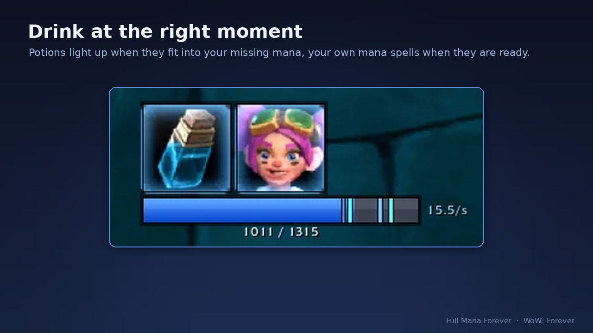
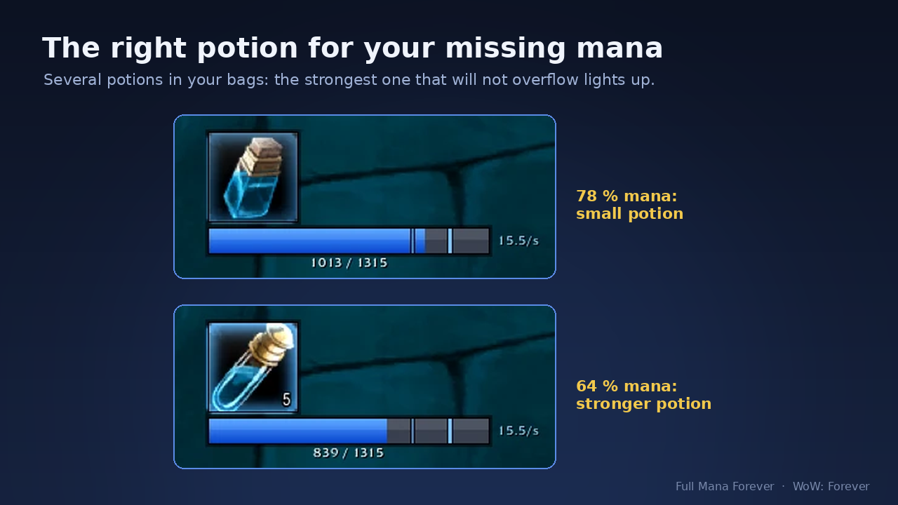
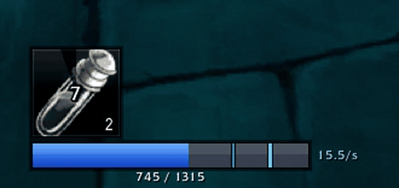
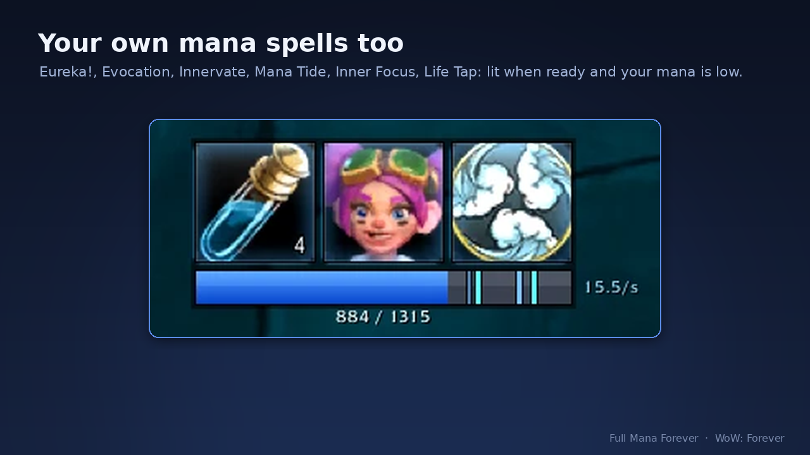
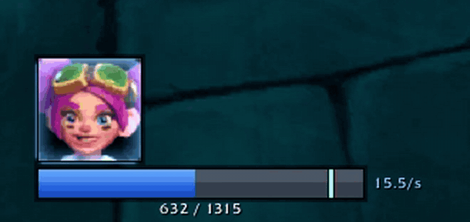
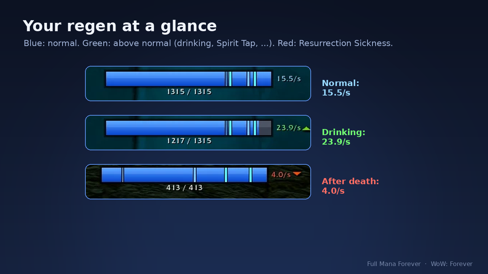

**The right mana potion at the right moment — for World of Warcraft: Forever (WoW Forever, Classic+).**

A mana potion, rune, mana gem or your own mana spell (Evocation, Innervate, Mana Tide, ...) lights up the moment it is ready **and** fits into your missing mana: nothing is wasted. Plus a compact mana bar with the **five-second rule (5SR)**, your **live mana regen per second, also in combat**, and the **time to full mana** while you drink. For healers and every other mana user: priests, druids, shamans, paladins, mages, warlocks and hunters.

*Features asked for in the comments get built. Tell us what you need: comment here or open an issue on [GitHub](https://github.com/KesaObscura/FullManaForever/issues).*

## What it does

### Potions, runes, gems and your own spells

- **Icons that light up at the right time.** One icon per cooldown group: mana potions, Demonic/Dark Runes, mage mana gems, other mana consumables, and use effects of equipped gear.
- **Right potion for the deficit.** With several potions in your bags, the icon shows the **strongest potion that will not overflow**: a weak one when you are slightly down, a strong one when you are low.
- **One simple setting: When to light up.** *No waste* waits until the whole potion fits. *More per fight* uses the average restore, so you drink earlier and fit more potions into a long fight. *Strongest only* keeps it simple.
- **Runes are safe.** A rune is only shown when you will keep a configurable share of your health after its damage (30 % by default).
- **Your own mana spells too.** Evocation, Innervate, Mana Tide Totem, Inner Focus, Life Tap and the racials Eureka! (gnome) and Read Leyline (Skyborne) light up when the spell is ready and your mana is at or below its own threshold (a sensible default per spell, changeable in the list). Two spells ready at once? Each gets its own icon. Life Tap lights up like a potion when its mana fits, with the same health check as runes. Forever hides spell cooldowns from addons in combat, so the addon counts them from your cast — never too early.
- **See it coming.** Potions, runes, gems, gear and your own spells already show in the last seconds of their cooldown — grey, counting down like your action bar — so you are ready the moment they light up. 5 seconds by default, up to 120 (the whole potion cooldown), or off.
- **Made for wanding.** Each wand shot blocks potions and spells for a moment. The icon stays lit and shows that short wait as a sweep, like the action bar: the potion fits, stop shooting and drink.
- **"Low mana!" and "Out of mana!" to your group.** Switch it on (party chat, raid chat or both) and the addon warns your group in a fight, at most every 30 seconds each. Each warning has its own switch and its own mark (30 % and 5 % of your mana by default). `/fmf oom` says "Out of mana!" at once. Off by default.
- **Hold potions.** `/fmf hold` (best in a macro) holds mana potions until the end of the next fight, for when you want the potion cooldown for something else. The potion icon turns grey with "HOLD"; after the fight it releases by itself.
- **Only what you can use:** items above your level, other classes' items and battleground-only items outside battlegrounds are skipped.

### Mana bar and five-second rule (5SR)

- **Mana bar with markers.** A compact mana bar with the current value and a marker for every potion step. Icons stand in the order they light up, so lit icons never leave a gap. Icons in a row or in a column, growing either way (to the left they start at the bar's far end), bar under, above, left or right; bar color, thickness and length (auto: room for the groups you switched on), icon size and spacing are adjustable, and every number can be typed in. Nothing is shown while you are dead or a ghost.
- **Works with unit frame addons.** In four steps: set *Style* to *Only markers* (under the mana bar), unlock the frame and tick *Move the bar separately*, drag the bar onto your unit frame's mana bar and match length and thickness to it, then tick *Above other frames*. *Only markers* hides the bar's fill, background and border: lay the potion markers and the five-second strip over the mana bar of your unit frame. *Move the bar separately* gives the bar its own place apart from the icons, and *Above other frames* draws everything on top.
- **Five-second rule.** After a spell that costs mana, a gold strip and the seconds next to the mana bar count down the 5 seconds of reduced regen (wands, potions and food do not start it) — in whole seconds (5, 4, 3 ...) or with tenths, or just the strip without the number. The strip runs down smoothly.
### Know when to drink: live mana regen and time to full mana

- **Time to full mana** out of combat: "full in ~27 s" next to the regen while you drink or rest, the five-second rule and the end of your drink included.
- **Live mana regen per second,** also in combat, including Spirit Tap and drinking. It turns **green** with a small up arrow when it is above your normal rate of the last minutes (drinking, Spirit Tap, ... out of combat; in combat after your own Evocation or Read Leyline, as Forever hides the value from addons in combat) and **red** with a down arrow while Resurrection Sickness holds it down.
- **Mana text** like the game's status text: numeric value, percentage or both, with its own switch and text size.
- **Your layout.** The mana numbers, the five-second seconds and the regen also show with the mana bar switched off, and *Move texts freely* lets you drag each of them anywhere.

### Comfort

- **Settings that explain themselves.** Hover any option for a short explanation. *Reset position* and *Reset size* undo your experiments in one click.
- **Items and spells.** See every supported item with icon, restore value and whether you carry it. Turn single items off (for example to save expensive potions) or add your own item to any category. Your class's mana spells are listed too, each with its own threshold, and if you do not have one yet, the list says why: the level, a talent or the trainer.
- **Profiles per character.** All characters share one set of settings, or a character gets its own (a copy of the shared ones to start with). Copy the settings of another character in one click, reset a profile or delete the settings of characters you no longer play; one undo if you clicked the wrong one. Language and your own items stay the same for all.
- **Sound when your potion is ready again** (optional): a short sound when the mana potion cooldown is over, also in combat; three sounds of the addon's own to choose from.
- **Show only where you need it.** Solo, in a party, in a raid — any combination, and optionally only in combat.
- **Fades out of combat if you like.** The bar and its texts fade to the opacity you choose, at full mana (spend mana and the bar is back at once), also in combat if you like, or after every fight. *Out of combat: Without icons* hides the icons between pulls and keeps the bar; *Show icons* off leaves just the bar.
- **9 languages:** English, Deutsch, Español (EU and AL), Français, Русский, 한국어, Português, 简体中文, 繁體中文.

## Looking for a mana tick or mp5 tracker in WoW Forever?

Forever's mana regen is continuous: there are no 2-second mana ticks, and addons cannot read your mana or regen in combat, so classic mana tick and mp5 trackers do not work here. Full Mana Forever shows what really counts in Forever: the **five-second rule** countdown after each spell and the **regen running right now, per second**, in and out of combat.

## Built for WoW Forever's addon rules

Forever hides your current mana, your buffs and your spell cooldowns from addons in combat. Full Mana Forever is built for these rules: the right icon still lights up at the right moment. No automation: the addon never uses an item or casts for you, you press the button.

## Supported items (checked against the Forever database)

- **Mana potions** (shared cooldown, read from the game): Major, Major Rejuvenation, Superior, Combat, Greater, Mana, Lesser, Minor, Minor Rejuvenation, the battleground draughts (Major/Superior Mana Draught), Dreamless Sleep and Greater Dreamless Sleep (off by default — they put you to sleep for 12 s), Wildvine Potion (off by default — it may restore nothing).
- **Runes:** Demonic Rune, Dark Rune.
- **Mana gems (mage):** Ruby, Citrine, Jade, Agate.
- **Other:** Night Dragon's Breath, Scroll of Minor Evocation (mage), Forever's Power Recycler (20 % of your max health into 20 % of your max mana, with the health check of the runes).
- **Gear:** Mindtap Talisman, Second Wind, Warmth of Forgiveness, Energy Cloak, Earthen Sigil, Major/Minor Recombobulator; for druids the Veildust Medicine Bag; for mages Robe of the Archmage, Celestial Orb, Arcane Orb and Ley Orb.

## Commands

| Command | Does |
|---|---|
| `/fmf` | open the settings |
| `/fmf items` | open the list of items and spells |
| `/fmf profile` | profile in use and characters with own settings; `/fmf profile shared` / `own` switches, `copy <name>` takes over another character's settings (first name and surname, or the first name alone when it is unique), `undo` takes back the last copy |
| `/fmf hold` | hold mana potions until the end of the next fight (grey "HOLD" icon); again releases them. Tip: put it in a macro |
| `/fmf unlock` / `/fmf lock` | move the icons |
| `/fmf test` | same as `/fmf unlock`: show everything that is switched on, to place the frame |
| `/fmf reset` | move the icons and the texts back to the default position |
| `/fmf reset size` | icon size, spacing, bar thickness, bar length and text sizes back to the defaults |
| `/fmf probe` | print API status for bug reports (also kept in the settings file) |
| `/fmf log on` / `/fmf log off` | record casts and regen for a bug report |

The settings are also in *Options → AddOns → Full Mana Forever* and in the addon menu at the minimap (left-click: settings, right-click: items and spells).

## FAQ

- **Does it work in combat?** Yes, it was built and tested for combat in Forever.
- **Does it drink for me?** No. The icon tells you when; you press your potion button.
- **Does it work in WoW Classic Era, Hardcore or retail?** No. It is made for World of Warcraft: Forever (client 1.60.1) and its addon rules.
- **Why does the icon not light up at 90 % mana?** *No waste*: it waits until the whole potion fits into your missing mana. Want to drink earlier? Switch *When to light up* to *More per fight*.
- **Different settings for my healer and my mage?** Yes: each character can have its own profile, or copy another character's settings.
- **How do I save my expensive potions?** Switch single items off in `/fmf items`, or hold potions for one fight with `/fmf hold`.
- **Does it work with my unit frames?** Yes: *Style: Only markers*, *Move the bar separately* and *Above other frames* lay the markers and the five-second strip over your unit frame's mana bar; type the exact length and thickness.
- **Does a healing potion block my mana potion?** Yes, in Forever they share the 2-minute cooldown; the icon then shows the wait.
- **How long do I have to drink?** Out of combat the regen shows "full in ~N s": the time until your mana is full at the current rate.

## Tested so far

- **In the live game** since launch (4 Nov) and in the beta, priest level 16–24: in combat, solo and in a full dungeon run.
- Potions (also a second potion after the 2-minute cooldown in the same fight), wanding, Eureka! and Inner Focus, Read Leyline on a Skyborne mage.
- Five-second rule and the regen colours: drinking, Spirit Tap, Read Leyline, Resurrection Sickness; fading out of combat; time to full mana while drinking.
- Profiles across several characters, `/fmf hold`, the icon order, the item list as priest, mage and druid.
- The bar over the mana bar of Forever Unit Frames (only markers, moved separately, above other frames).
- Items, restore values and the shared potion cooldown checked against the game's own item data.
- **Not confirmed in game yet:** level-60 items (runes, raid trinkets), Evocation, Innervate, Mana Tide, Life Tap and druid forms. Playing one of them? Tell us in the comments.

## Planned

Pre-pull checklist (consumables, buffs), who in your group has Innervate / Mana Tide ready, group sync of mana cooldowns (Innervate, Mana Tide) and a helper for the druid or shaman giving them out.

## Bug reports

Please include the output of `/fmf probe` (it is also kept in `FullManaForever.lua`, see below), your class and level, and what you expected. Lua errors are easiest to read with BugGrabber + BugSack.

For the five-second rule or the regen display: `/fmf log on`, play until it happens, `/fmf log off`, `/reload`, and attach `WTF\Account\ACCOUNTNAME\SavedVariables\FullManaForever.lua` (class, level, casts and regen values, never other players' names; the file also holds your own characters' names and realms from the profiles — remove them before sharing if you like).

Source code and issues: [GitHub](https://github.com/KesaObscura/FullManaForever).

Vollständig auf Deutsch · Totalmente en español · Entièrement en français · Полностью на русском · 한국어 완전 지원 · Totalmente em português · 完整简体中文 · 完整繁體中文 — the addon follows your game language.

- **Deutsch:** Zeigt den passenden Manatrank, die Rune, den Manaedelstein oder eigenen Manazauber, sobald er bereit ist und in dein fehlendes Mana passt. Manaleiste mit Fünf-Sekunden-Regel, aktueller Manaregeneration und Zeit bis volles Mana.
- **Español:** Muestra la poción de maná, runa, gema de maná o hechizo de maná adecuado cuando está listo y cabe en tu maná que falta. Barra de maná con la regla de los cinco segundos, regeneración en vivo y tiempo hasta maná lleno.
- **Français :** Affiche la bonne potion de mana, rune, gemme de mana ou sort de mana dès qu'il est prêt et tient dans ton mana manquant. Barre de mana avec la règle des cinq secondes, la régénération en direct et le temps avant mana plein.
- **Русский:** Подсвечивает подходящее зелье маны, руну, камень маны или своё умение, когда оно готово и влезает в недостающую ману. Полоса маны с правилом пяти секунд, текущим регеном и временем до полной маны.
- **한국어:** 준비되었고 부족한 마나에 딱 맞을 때 알맞은 마나 물약, 룬, 마나석 또는 자신의 마나 주문을 표시합니다. 5초 규칙, 실시간 마나 회복, 마나가 가득 찰 때까지의 시간을 보여 주는 마나 바.
- **Português:** Mostra a poção de mana, runa, gema de mana ou feitiço de mana certo quando está pronto e cabe na mana que falta. Barra de mana com a regra dos cinco segundos, regeneração ao vivo e tempo até a mana cheia.
- **简体中文：** 当合适的法力药水、符文、法力宝石或自身法力技能就绪且恰好补满缺失的法力时将其点亮。带五秒规则、实时法力回复和法力回满时间的法力条。
- **繁體中文：** 當合適的法力藥水、符文、法力寶石或自身法力技能就緒且剛好補滿缺少的法力時將其點亮。帶五秒規則、即時法力回復和法力回滿時間的法力條。
